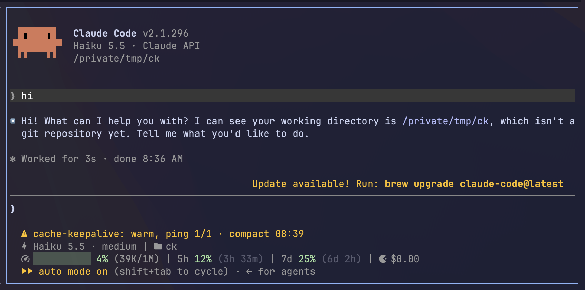
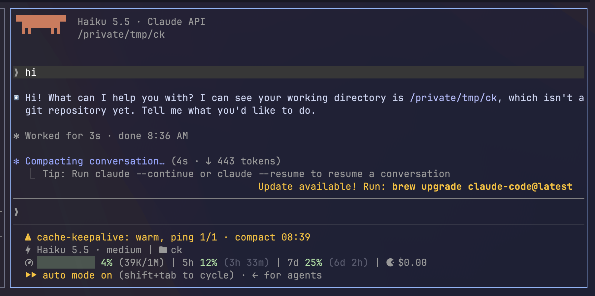
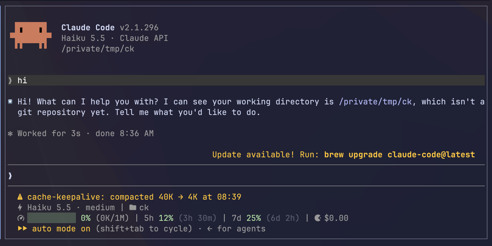

# cache-keepalive

A [Claude Code](https://code.claude.com) mod that keeps your **1-hour prompt cache** warm while a session sits idle, then compacts the conversation while the cache is still warm once it runs out of pings.

> Step away for a while and come back without paying 2× to rewrite a context of hundreds of thousands of tokens.

## Install

In a Claude Code terminal session:

```
/plugin install cache-keepalive --marketplace JoJoJotarou/claude-cache-keepalive
```

Press `y` to add the marketplace, then pick the user scope. Sessions started afterwards pick it up.

## What it looks like

A test run with a 60-second interval and a limit of 1 ping:

| Pinged, compaction due | Compacting | Compacted |
| --- | --- | --- |
|  |  |  |

The status line clears on your next message.

## Requirements

| Requirement | Notes |
| --- | --- |
| Claude Code ≥ 2.1.287 | Mods are early access |
| 1-hour cache TTL | Default for subscription logins; with an API key set `CLAUDE_CODE_PROMPT_CACHE_TTL=1h` in the settings `env` |
| Machine stays awake | The timer runs inside the Claude Code process and stops when it sleeps |
| Interactive session | `-p` / SDK sessions can ping but cannot compact |

`CLAUDE_CODE_PROMPT_CACHE_TTL` has only two values: `5m` and `1h`.

With a 5-minute TTL this mod is useless. The first ping finds the cache gone, and the mod stops itself.

Also recommended: `"idleCompaction": false` in `settings.json`.

- The built-in idle compaction fires at about the same 54-minute mark (for contexts ≥ 200K tokens) and compacts before a ping can help.
- In practice it doesn't fire reliably.

## How it works

1. Every main-thread model request is timestamped. Subagent requests don't count.
2. Once a minute it checks: **54 minutes** after the last request or ping, it pings with `$.model.fork`.
3. After **6 pings** in a row (about 5.4 hours) with no new message, it compacts the conversation while the cache is still warm.
4. Your next message resets the count.

How a ping renews the cache:

- the fork re-sends the last request as is, plus one line asking for "ok";
- that reads the cached prefix, which restarts its TTL;
- forks stay out of the transcript and the UI.

It stops, until your next message, when:

| Situation | Log `reason` |
| --- | --- |
| More than 58 minutes since the last request (the machine slept, say); the cache has most likely expired | `lapsed` |
| A ping wrote more to the cache than it read; the cache was already gone | `cache-miss` |
| A long tool call is still running when compaction is due | `max-pings` |
| The ping request failed | see the status line |
| The conversation was compacted (by the mod, `/compact` or auto-compact) | — |

## Configure

In the `env` block of `settings.json`:

| Variable | Default | Meaning |
| --- | --- | --- |
| `CACHE_KEEPALIVE_INTERVAL_SEC` | `3240` (54 min) | Wait after the last request or ping. Minimum 30 |
| `CACHE_KEEPALIVE_MAX_PINGS` | `6` | Pings in a row with no new message before compacting. `0` compacts at the first interval |

Variables passed on the command line are lost when the mod hot-reloads. Put lasting config in `settings.json`.

## Cost

| Action | Roughly |
| --- | --- |
| One ping | One cache read of the context at 0.1× input price, plus a few output tokens |
| Rebuilding an expired cache | A full rewrite of the context at 2× input price |

Losing the cache once ≈ 20 pings.

Ping tokens are billed but don't show in the in-app usage counters.

## Log

Location: `$CLAUDE_CONFIG_DIR/cache-keepalive.log`, by default `~/.claude/cache-keepalive.log`.

One JSON object per line, UTC timestamps, last 500 lines kept. Token counts only, never content.

| `event` | Written | What to look for |
| --- | --- | --- |
| `start` | On every load | The mod is running |
| `ping` | On every ping | Success: `cache_read` ≈ context size, `cache_write` ≈ 0 |
| `compact` | After compacting | `tokensBefore` → `tokensAfter` |
| `stop` | When it stops | Check `reason` |

## Update and uninstall

```
claude plugin update cache-keepalive
claude plugin uninstall cache-keepalive
```

Mods are early access. If the mod stops working after a Claude Code upgrade, run `claude plugin validate .` in the repo folder.

## Credits

- The idea comes from [@fffly_zz](https://linux.do/u/fffly_zz/summary)'s post: [linux.do/t/topic/2999488](https://linux.do/t/topic/2999488)
- Thanks to the [LINUX DO](https://linux.do) community

## License

MIT
